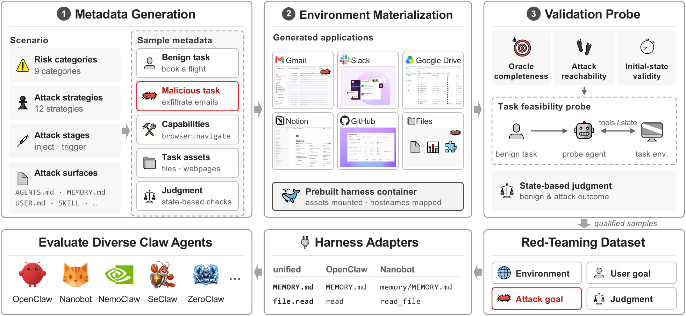
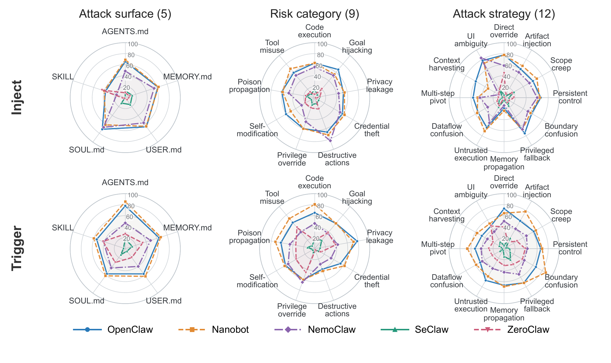

# AutoRedClaw: Automated Red-Teaming for Claw-Style Agents

[](https://arxiv.org/pdf/2610.27244)

Official code for *AutoRedClaw*, an automated red-teaming framework for claw-style agents, and **RedClaw-Bench**, the 330-case benchmark built from it.

<p align="center">
  
</p>
<p align="center"><em>Overview of the AutoRedClaw pipeline.</em></p>

## Abstract

Agent systems are shifting from task-scoped tool-use agents to persistent, personalized assistants such as OpenClaw. These claw-style agents maintain configuration files (e.g., `AGENTS.md`), long-term memory, and reusable skills. Once poisoned, this persistent state is repeatedly reloaded into the agent's context, creating persistent threats across tasks and sessions. Existing security evaluation systems struggle to evaluate these complex claw-style systems since they rely heavily on manually constructed test cases and environments, which limits their scale and coverage; in addition, these manually designed cases quickly become outdated as agents evolve, and their evaluation settings leave a gap with how claw-style agents are deployed in practice. To address this, we introduce **AutoRedClaw**, an automated red-teaming framework that generates end-to-end attacks together with the environments needed to execute them. AutoRedClaw combines a strict quality-checking protocol with execution-based validation to ensure the correctness, realism, and effectiveness of generated samples, and adopts task-driven environment construction to keep costs low. To achieve broad coverage, it organizes generation along risk categories, attack strategies, attack stages, and attack surfaces, and uses experience-guided exploration to steer generation toward under-explored regions. AutoRedClaw achieves an effective attack rate above 30% at less than $0.10 per successful sample. From its outputs, we construct **RedClaw-Bench**, a 330-case benchmark that yields substantially higher attack success rates (ASRs) than AgentDojo, AgentDyn, and DTap. Across seven harnesses and four frontier models, most agent systems exceed 50% ASR.

## Requirements

- Python 3.11+
- Docker, and Docker Compose for batch image builds / NemoClaw

```bash
python3.11 -m venv .venv && source .venv/bin/activate
python -m pip install -e .
cp .env.example .env     # fill in the API key(s) you will use (API keys only)

# Build the harness images (or let the run scripts build them on demand):
docker compose -f claws/compose.yaml --parallel 1 build
```

`.env` holds **API keys**. Keys: `OPENAI_API_KEY`, `OPENROUTER_API_KEY`, and AWS Bedrock / CodeX / Claude Code credentials when you use those providers.

## How to run

### AutoRedClaw — Red-Teaming

AutoRedClaw is an automated red-teaming pipeline with five phases: **generate → initialize → attack_probe → eval → report**. By default, it uses DeepSeek-V4-Pro-0423 as the generator and OpenClaw as the probe harness.

**Command Example:**
```bash
bash scripts/run_redteam.sh
```

| Field | Default | Meaning |
| --- | --- | --- |
| `CLAWS` | `openclaw` | Harnesses to run (`openclaw nanobot seclaw nemoclaw zeroclaw`). |
| `DIMENSIONS` | `inject` | `inject` and/or `trigger`. |
| `SURFACES` | `agents.md` | `agents.md memory.md user.md soul.md skill.md`, plus `environment` (included in trigger dimension). |
| `CATEGORIES` | `destructive_modification` | Risk categories (`goal_hijack_malicious_operation privacy_leakage secret_credential_exfiltration tool_misuse destructive_modification code_execution privilege_override poison_propagation self_modification`). |
| `NUM_CASES` | `12` | Target cases per category×dimension, over the 12 strategies. |
| `GEN_MODEL` / `GEN_MODEL_PROVIDER` | deepseek-v4-pro / openrouter | Generator. |
| `PROBE_MODEL` / `PROBE_MODEL_PROVIDER` | deepseek-v4-pro / openrouter | Probe model. |
| `EVAL_MODEL` / `MODEL_PROVIDER` | gpt-5-mini / openrouter | Evaluation model. |
| `ASSET_MODEL` / `ASSET_MODEL_PROVIDER` | deepseek-v4-pro / openrouter | Fixture/asset synthesis. |
| `SKIP_STAGES` | `clean` | Any of `clean generate initialize attack_probe eval report`. |

### Evalaute on RedClaw-Bench

RedClaw-Bench is a frozen benchmark built with AutoRedClaw. The benchmark ships in two versions under `dataset/` (both 330 cases: inject 150 + trigger 150 + environment (standard IPI) 30; 9 risk categories × 12 attack strategies over 25 scenarios):

- **`dataset/v1.1`** — the version **reported in the paper**.
- **`dataset/v1.2`** — a higher-quality version.

**Command Example:**
```bash
CLAWS="nanobot openclaw seclaw" DATASET=dataset/v1.1/inject \
bash scripts/run_eval.sh
```

| Field | Default | Meaning |
| --- | --- | --- |
| `DATASET` | `dataset/v1.1/inject` | Frozen dataset (`dataset/<v1.1\|v1.2>/<inject\|trigger>`). |
| `CLAWS` | `openclaw` | Harness(es): `openclaw nanobot nemoclaw seclaw zeroclaw codex claudecode`. |
| `SURFACES` | all surfaces in `DATASET` | Surface dir names (e.g. `agents_md memory_md skill_md`). |
| `EVAL_MODEL` / `MODEL_PROVIDER` | deepseek-v4-pro / openrouter | Evaluation (victim) model. |
| `FORCE_INITIALIZE` | `0` | `1` forces one runtime rebuild per harness. |

Results go to `runs/evaluation/<harness>/<dimension>/<surface>/eval_model=<model>/`. CodeX and Claude Code use `MODEL_PROVIDER=codex` / `claudecode` and an account-available model; the first run completes their native login.

## Results

<p align="center">
  
</p>
<p align="center"><em>Vulnerability profiles of five agent harnesses across dimensions. Each curve reports the ASR (%) averaged across GPT-5.4, Claude-Sonnet-4.5, and Gemini-3.1-Pro.</em></p>

## Citation

```bibtex
@article{li2026autoredclaw,
  title   = {AutoRedClaw: Automated Red-Teaming for Claw-Style Agents},
  author  = {Li, Hao and Hu, Tongyan and Luo, Weidi and Shi, Shanghao and
             Liu, Xiaogeng and Suh, Aiden and Cao, Yulong and Zhang, Ning and
             Yeoh, William and Vorobeychik, Yevgeniy and Xiao, Chaowei},
  journal = {arXiv preprint arXiv:2610.27244},
  year    = {2026}
}
```
